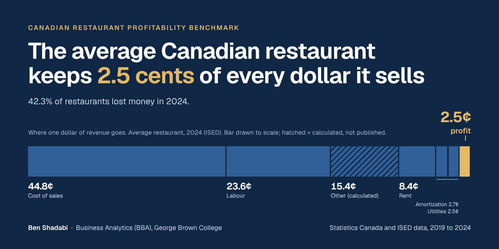
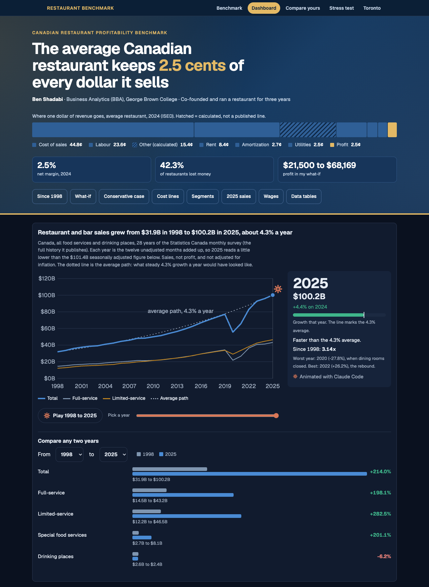
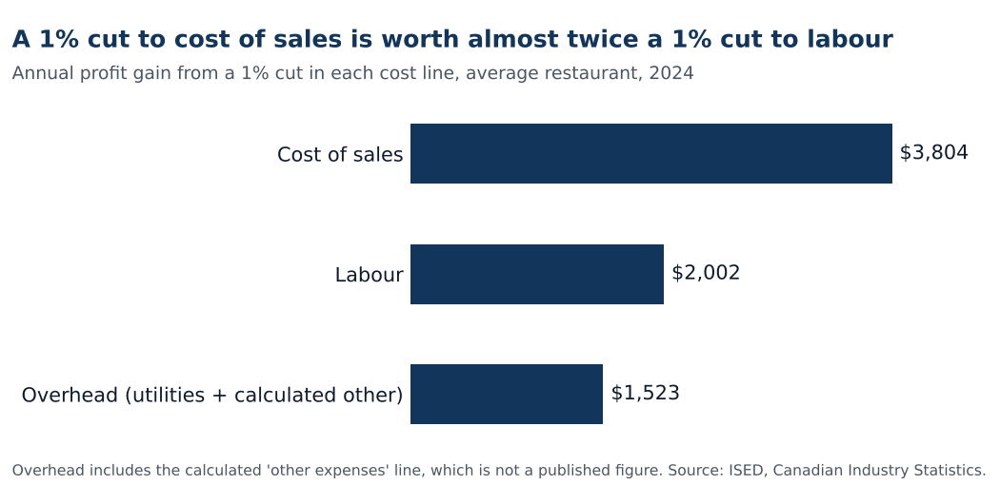
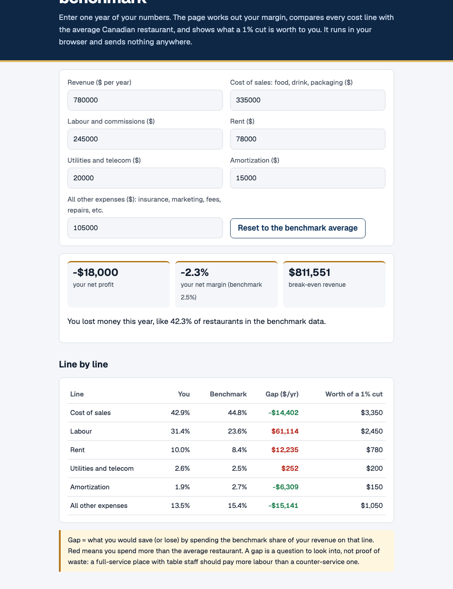
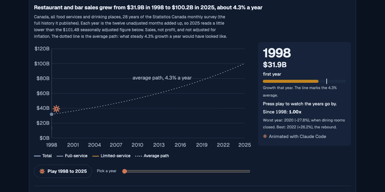
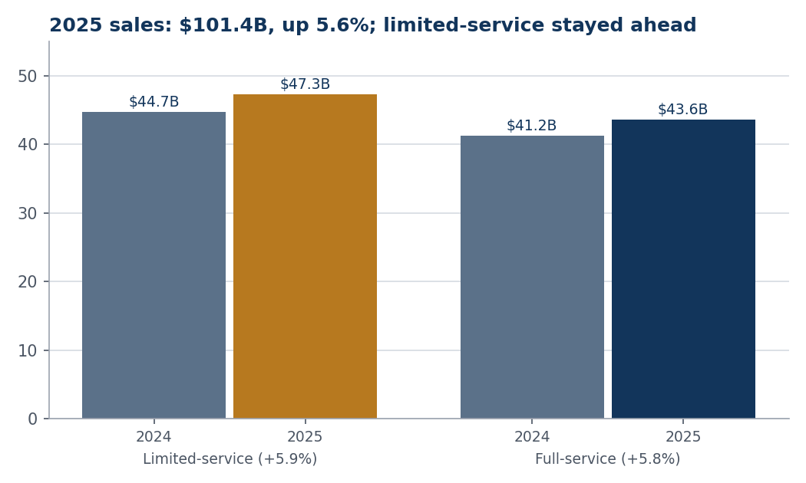
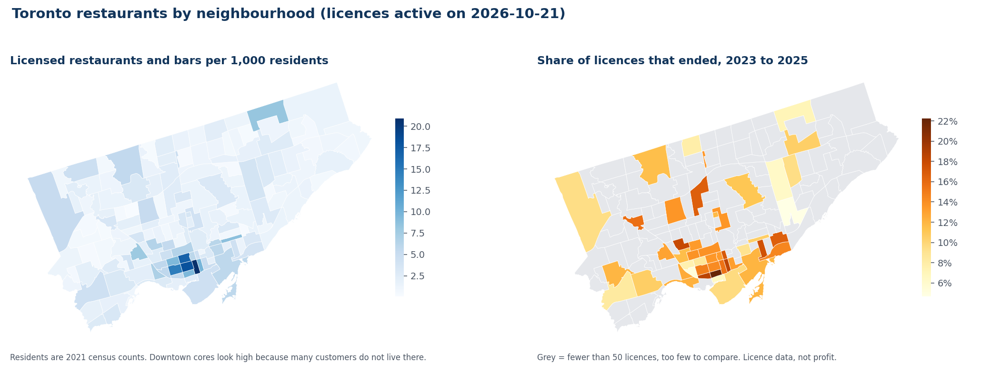

# Canadian Restaurant Profitability Benchmark (2019 to 2024)

[](https://github.com/BenShadabi/canadian-restaurant-profitability-benchmark/actions/workflows/checks.yml)



## Live pages
| Page | What it does |
|---|---|
| [Dashboard](https://benshadabi.github.io/canadian-restaurant-profitability-benchmark/dashboard.html) | Six charts, sales since 1998 (animated), dark mode and tooltips |
| [Calculator](https://benshadabi.github.io/canadian-restaurant-profitability-benchmark/calculator.html) | Compare your own restaurant's costs with the benchmark, with a 3D stack of costs that turns red when costs pass revenue |
| [Stress test](https://benshadabi.github.io/canadian-restaurant-profitability-benchmark/stress.html) | Move food cost, wages, rent and sales and see the profit effect |
| [Toronto side project](https://benshadabi.github.io/canadian-restaurant-profitability-benchmark/toronto.html) | Restaurant licences and closures by neighbourhood |
| [Methodology](docs/methodology.md) | Sources, definitions and limits |

**Business question:** where does a typical Canadian restaurant make and lose money, and how much would tighter labour, overhead and waste control change its profit?

I'm Ben Shadabi, a Business Analytics (BBA) student at George Brown College in Toronto. I built this with Claude Code. I co-founded and managed a dine-in and take-out restaurant for three years, so I know which numbers matter in this industry, and this project tests those ideas against public data. Every figure comes from the published releases linked in `docs/methodology.md`.

[Project page](https://benshadabi.github.io/canadian-restaurant-profitability-benchmark/), [dashboard](https://benshadabi.github.io/canadian-restaurant-profitability-benchmark/dashboard.html) and [calculator to compare your own restaurant](https://benshadabi.github.io/canadian-restaurant-profitability-benchmark/calculator.html) are live web pages, so these links open the finished pages. (Clicking the files inside the `docs` folder on GitHub shows their code instead.) The dashboard has a dark mode and hover tooltips on the charts.



All six charts as one image: [assets/dashboard.png](assets/dashboard.png).

## Where to look
- **Just want to see it?** Use the links at the top. They open the finished pages.
- **Want the code?** `analysis/` has the Python (scenario, charts, dashboard, stress test, Toronto work), `sql/queries.sql` has the 8 SQL queries, `data/` has the CSVs and the Excel workbook, and `checks.py` recomputes every headline number.
- **Want the method and limits?** [docs/methodology.md](docs/methodology.md).

## Key findings
1. Margins are thin. The average Canadian restaurant earned a 2.5% net profit margin in 2024 ($21,500 on $849,200 revenue). 42.3% of restaurants lost money. Industry-wide operating margin was 4.1%.
2. Cost of sales and labour take about 68 cents of each dollar (44.8% and 23.6% of revenue for the average restaurant). Rent is 8.4%.
3. Counter-service restaurants held up better in the pandemic. In 2020, full-service restaurants' operating margin fell to 0.3% while limited-service places earned 5.3% (6.9% in 2021). Limited-service revenue was ahead of full-service in 2020, 2021 and 2024 ($44.9B vs $44.2B in 2024).
4. Wages are rising. Average hourly pay in food services went from $16.78 (2020) to $19.48 (2024), up 16.1%.
5. Small cost gains move profit a lot. Profit is only 2.5% of revenue, so a 35% profit increase needs about $7,500 a year. That equals a 3.8% labour cut alone, or a 2.0% cut to cost of sales.

## What-if scenario (average restaurant)
| Lever | Assumption | Headline case | Conservative case |
|---|---|---|---|
| Labour cost | -10% | +$20,020 | +$20,020 |
| Overhead | -15% | +$22,845 (utilities, telecom and other) | +$3,225 (utilities and telecom only) |
| Food waste | -20% of an assumed 5% waste share of cost of sales | +$3,804 | +$3,804 |
| Total | | $21,500 to $68,169 (margin 2.5% to 8.0%) | $21,500 to $48,549 (margin 2.5% to 5.7%) |

These are the levers I used when running my own restaurant. Here I apply them to the industry average as a what-if. It is not a forecast and says nothing about any one business.

Two things to know before you trust the headline number:
- The overhead gain uses a calculated line. "Other expenses" ($130,800) is revenue minus every listed cost and profit. It is not a published figure, and it makes up $19,620 of the $22,845 overhead gain. The conservative case leaves it out, and profit still more than doubles.
- The waste share is my assumption. It matters little: testing 2% to 8% moves the headline profit between $65,887 and $70,451 (`data/waste_share_range.csv`). You can change it in the workbook.



A 1% cut to cost of sales is worth $3,804 a year, almost twice a 1% cut to labour ($2,002).

## Try it: compare your own restaurant
[the calculator](https://benshadabi.github.io/canadian-restaurant-profitability-benchmark/calculator.html) takes one year of your numbers and compares each cost line with the benchmark, then shows your margin, break-even revenue and what a 1% cut is worth. It runs in the browser and sends nothing anywhere. The picture below is a made-up example restaurant that loses $18,000, mainly because labour is 31.4% of revenue against a 23.6% benchmark.



## Sales since 1998 (animated)


The dashboard now opens with 28 years of sales, the full history of the Statistics Canada monthly survey (`data/sales_history.csv`). Press play and the line is drawn one year at a time, with each year's growth set against the long-run average. You can also drag to any year, compare any two years side by side, and switch to **After inflation** to see every year in 2025 dollars. [Watch the video](assets/sales_history.mp4).
- Sales went from $31.9B in 1998 to $100.2B in 2025, 3.14 times as much. That is about 4.3% a year on average.
- After inflation it is about 2.1% a year. In 2025 dollars, 1998 sales were $57.4B, so real sales grew 1.75 times, not 3.14. About half of the growth was rising prices (all-items Consumer Price Index).
- The worst year was 2020 (-27.8%), when dining rooms closed. The best was 2022 (+26.2%), when they reopened.
- Limited-service grew the most (+282.5%) and passed full-service. Drinking places are smaller than in 1998 (-6.2%).
- Each year is the twelve unadjusted months added up, so 2025 reads $100.2B here against the seasonally adjusted $101.4B below. These are sales, not profit. Profit margins are only published from 2019, so the profit analysis does not go back further.

## 2025 update (sales only)


Statistics Canada has not published 2025 margins or cost shares yet, so the profit analysis stays at 2024. The monthly sales survey does cover 2025 (`data/sales_2025.csv`):
- Food services and drinking places: $101.4B, up 5.6% on 2024.
- Limited-service eating places: $47.3B (+5.9%). Full-service restaurants: $43.6B (+5.8%). Limited-service stayed ahead. Drinking places: -2.3%.
- This is a different basis from the annual operating revenue above ($99.6B in 2024), so the two are not combined. Some of the growth is price: a tax break on restaurant food started on December 14, 2024.
- I checked these figures against the Statistics Canada release itself (The Daily, 2026-02-25) on 2026-10-24.

## Stress test: inflation, wages, rent and falling sales
[the stress test page](https://benshadabi.github.io/canadian-restaurant-profitability-benchmark/stress.html) lets you move sliders for food costs, wages, rent, other costs, menu prices and sales volume and see what happens to the average restaurant's profit, with presets (a typical recent year, a minimum wage step, construction outside the door, everything at once). With a 2.5% margin, sales falling just 5.3% wipes out the average restaurant's profit. It is a what-if, not a forecast. The sources it cites (menu price inflation, Ontario minimum wage history, Restaurants Canada's 2025 survey, closure estimates) are listed on the page with notes on what I could not verify. The code is `analysis/stress_model.py` and `analysis/build_stress.py`.

## Toronto side project: restaurants by neighbourhood
[the Toronto page](https://benshadabi.github.io/canadian-restaurant-profitability-benchmark/toronto.html) is a separate analysis from the national profit work above. It uses City of Toronto open data (business licences, DineSafe, neighbourhood and BIA boundaries, 2021 census population) to show licensed restaurants and bars per 1,000 residents and the share of licences that ended from 2023 to 2025, for the 158 neighbourhoods and 86 business improvement areas.



An exploratory section asks whether licences near large construction sites ended more often. They did (12.7% against 9.1%), but about as much near sites that had already finished, so the data cannot show that construction caused closures, and Metrolinx transit works are not in the City permit data. It counts licences. It does not estimate profit, because no public source reports profit for a neighbourhood. A cancelled licence is also not always a closed restaurant, and licences are placed by matching addresses, which is approximate. The page lists these limits. The raw files (about 450 MB) are downloaded by `analysis/toronto_download.py` and not stored here, and `data/toronto_*.csv` hold the results.

## Data
| Dataset | Source | Years |
|---|---|---|
| Average restaurant financials (NAICS 7225, 65,071 businesses, revenue $30k to $5M) | ISED Canadian Industry Statistics, based on Statistics Canada data | 2024 |
| Revenue, margin and cost shares, full-service vs limited-service | Statistics Canada, The Daily, annual food services releases | 2019 to 2024 |
| Average hourly wage, accommodation and food services | Statistics Canada Table 14-10-0206-01 (via ISED) | 2020 to 2024 |

All figures are typed from the published releases (links in `docs/methodology.md`). Contains information licensed under the Open Government Licence - Canada. The page font, Geist, is under the SIL Open Font License (`docs/fonts/`).

## Repository
```
data/
  Canadian_Restaurant_Benchmark.xlsx   workbook: Benchmark, Industry_Trend, Scenario, Wages, Sources
  industry_trend.csv                   annual industry series 2019-2024
  average_restaurant_2024.csv          average restaurant P&L and quartiles
  wages_food_services.csv              hourly wage series
  restaurant_counts_2024.csv           business count and share of restaurants with a loss
  sensitivity_labour_overhead.csv      profit at different labour and overhead cuts
  scenario_cases.csv                   before, conservative and headline cases
  lever_per_point.csv                  profit gain from a 1% cut in each cost line
  waste_share_range.csv                profit for an assumed waste share of 2% to 8%
  toronto_neighbourhoods.csv           Toronto: licences per 1,000 residents and 2023-2025 licence exits, 158 neighbourhoods
  toronto_bia.csv                      the same for 86 business improvement areas
  toronto_match_summary.csv            how many licences were placed on the map, and how
  sales_2025.csv                       2025 sales by segment from the monthly survey (sales only, no margins yet)
  sales_history.csv                    yearly sales by segment, 1998 to 2025, from the same survey
  cpi_canada.csv                       yearly all-items Consumer Price Index, 1998 to 2025, used for the after-inflation view
analysis/scenario.py                   the scenario maths, read from the CSVs
analysis/build_scenarios.py            writes the three scenario CSVs and assets/lever_per_point.png
analysis/add_scenario_rows.py          one-off helper that added the conservative rows to the workbook (keeps its charts)
analysis/build_charts.py               rebuilds every PNG chart from the CSVs
analysis/build_dashboard.py            rebuilds docs/dashboard.html (the dashboard) from the CSVs
analysis/build_banner.py               redraws assets/banner.png from the CSVs (needs playwright and chromium)
checks.py                              recomputes every headline number and checks the README, dashboard and workbook match
.github/workflows/checks.yml           runs checks.py on every push
assets/                                title picture, dashboard and individual charts
sql/queries.sql                        8 SQL queries on the same data (window functions, CTEs)
sql/run_queries.py                     loads the CSVs into SQLite, runs the queries, writes sql/results.md
analysis/toronto_download.py, build_toronto.py, build_toronto_charts.py, build_toronto_page.py   the Toronto side project (see above)
docs/toronto.html                      Toronto neighbourhood page
docs/stress.html                       cost-shock simulator with sliders and presets
docs/calculator.html                   compare your own restaurant's numbers with the benchmark, with a 3D view (runs in the browser; three.js from a CDN)
docs/index.html, docs/dashboard.html   project page and dashboard (fonts/ holds the Geist font)
docs/methodology.md                    definitions, sources, limitations
requirements.txt                       pandas, matplotlib, tabulate, openpyxl
```

## How to reproduce
```
pip install -r requirements.txt
python analysis/build_charts.py
python analysis/build_scenarios.py
python analysis/build_dashboard.py
python sql/run_queries.py
python analysis/build_toronto.py   # optional: needs the Toronto download first (python analysis/toronto_download.py)
python checks.py
```
`checks.py` recomputes every headline number from the CSVs and fails if the README, the dashboard, the project page, the SQL results or the workbook inputs disagree with the data. To test other cuts, open the workbook and change the blue cells on the Scenario tab. The title picture and the dashboard pictures and video need a browser, so they are not in the list above (`pip install playwright`, then `python analysis/build_banner.py`; for the sales video, serve `docs` locally and run `python analysis/build_sales_video.py`, which needs Google Chrome, pillow and imageio-ffmpeg).

## Limitations
- Averages hide wide differences between restaurants. The bottom quartile averaged a $13,000 loss while the top quartile averaged a $90,600 profit.
- The two sources use different bases. ISED reports net profit for small restaurants (2.5% margin) and Statistics Canada reports operating profit for the whole industry (4.1%). I only compare lines within one source.
- Full-service plus limited-service revenue is less than the industry total ($89.1B vs $99.6B in 2024) because drinking places and other food services are not shown.
- Some 2019 and 2022 figures come from later releases that compare back to those years (Statistics Canada revised 2022 in 2024). Statistics Canada also revised 2020 later (full-service margin 0.5% instead of 0.3%), so I use the first published figures and say so. Segment margins for 2023 and 2024 were not published, and the 2019 limited-service margin is not stated in the releases, so those are blank.
- The scenario results are what-ifs on an average restaurant, not forecasts. The headline overhead cut applies to a calculated line, so treat the conservative case ($48,549) as the safer number.
